# 👻 Scary Money Manager

### Your money, your device, your ghost. A private money manager in **one HTML file**, where Chrome's **on-device AI** keeps real double-entry books from plain words, and the whole app gets spookier as your net worth sinks.

**▶ Live app:** https://julianfrank.github.io/kiroween2026/ &nbsp;·&nbsp; Built for **Kiroween 2026** with [Kiro](https://kiro.dev) &nbsp;·&nbsp; [MIT licence](LICENSE)

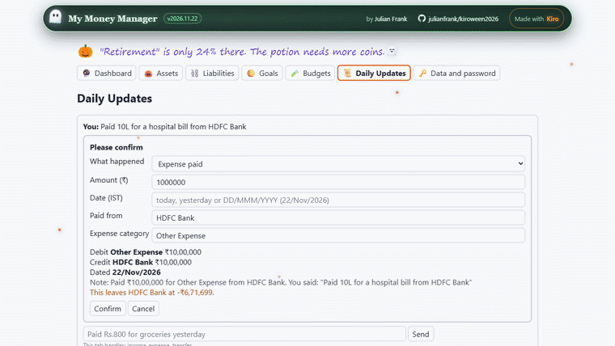

*One sentence, one Confirm, and the lights go out: a ₹10 lakh hospital bill takes net worth below zero. The coins fly, the title turns from "My Money Manager" to "Scary Money Manager", and the ghost rewrites its note.*

---

## The pitch

Every money app wants the same three things: your bank login, your spending history on its server, and your time spent filling in forms. Scary Money Manager asks for none of them.

- **Type what happened.** "I've taken a loan of Rs.5000 from Tom." "Paid 800 for groceries yesterday." "My Delhi flat is now worth 85L."
- **The AI on your own laptop** (Gemini Nano, built into Chrome) turns each sentence into a proposed double-entry Entry. **Nothing is sent anywhere.**
- **The app checks every number**, balances the books, resolves the date in IST and shows you a Confirm Card. Nothing is saved until you press Confirm.
- **Everything is encrypted** with a password that is never stored, in a single HTML file you can open from disk, email to yourself or host on GitHub Pages.
- **And it is honest with you.** The theme, the title and a hand-writing ghost all tell you the truth about your finances, with a joke.

It is for anyone who wants real bookkeeping without handing their financial life to a server, starting with people in India: whole rupees with lakh and crore grouping, and dates in IST as DD/MMM/YYYY.

## Five things judges should notice

| | |
|---|---|
| 🧠 **Local AI, used carefully** | The on-device model only *names* things: the kind of entry, the accounts and the date words. The app reads every **amount**, **date** and **account** from your own words, because the real model turned "30L" into ₹3 crore. A 36-sentence golden set runs against the real model inside the app: **86% → 97% → 100%** across three runs, each failure turned into a regression test. |
| 🔐 **Security you can audit** | PBKDF2-SHA256 (600,000 iterations) → AES-256-GCM with a fresh IV for **every value**. Keys are opaque IDs, so names and amounts never appear in plain text. The password is never stored; a verifier string proves it. Import checks the password and **every item** before touching anything, then swaps the store in **one IndexedDB transaction**. |
| 📒 **Real accounting, not a toy** | Every Entry balances (debits = credits). The Ledger is **append-only**: mistakes are fixed with a Reversal and a Correction, each with a Note. Setup opens only when Assets = Liabilities + Opening Equity. Revaluations are booked as profit or loss. |
| 🎃 **A theme that tells the truth** | Light above zero, Dark below zero, Twilight within 5% of total assets either side of zero. The title flips between "My Money Manager" and "Scary Money Manager". Over-budget bars shake, reached goals glow, and every Entry plays its own animation. |
| 👻 **Witty, ghost-assisted UX** | A ghost covers its eyes while you type your password and shakes its head at a wrong one. It cheers when your opening books balance, and hand-writes a funny, **true** line about your situation, naming real figures. |

## A tour of the app

### 1. The crypt: waking the on-device AI
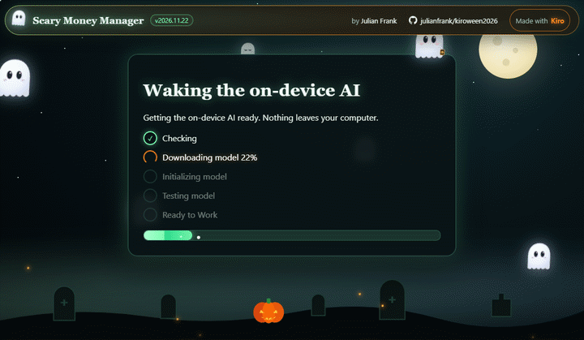

The app checks Chrome's built-in AI, downloads the model if needed (with progress), initialises it and tests it with a prompt before going any further. Every screen before the books open lives in "the crypt": a moonlit graveyard where Kiro-style ghosts fly through the fog. A guard ghost carries a lantern while the model loads.

### 2. One password, four ways in
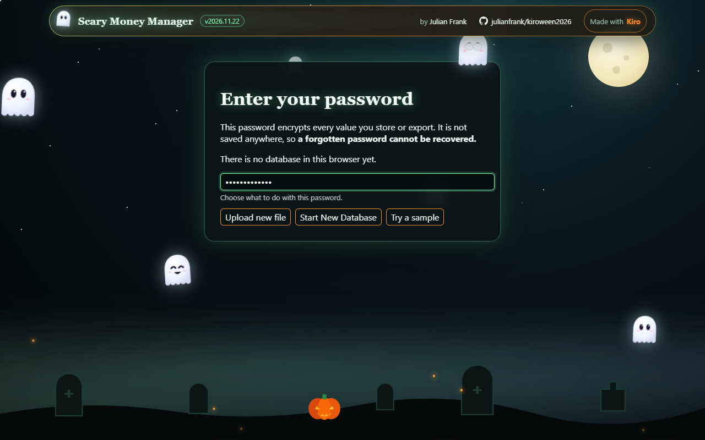

One password field (at least 7 characters) opens everything: **Unlock** your database, **Upload** an export file, **Start a New Database**, or **Try a sample** (two ready-made sets of books, 25 transactions each, dated up to today). The ghost covers its eyes while you type. It works on a phone screen too:

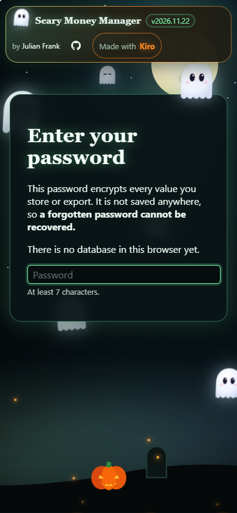

### 3. Opening balances that must balance
| Unbalanced: the ghost worries | Balanced: the ghost cheers |
|---|---|
| 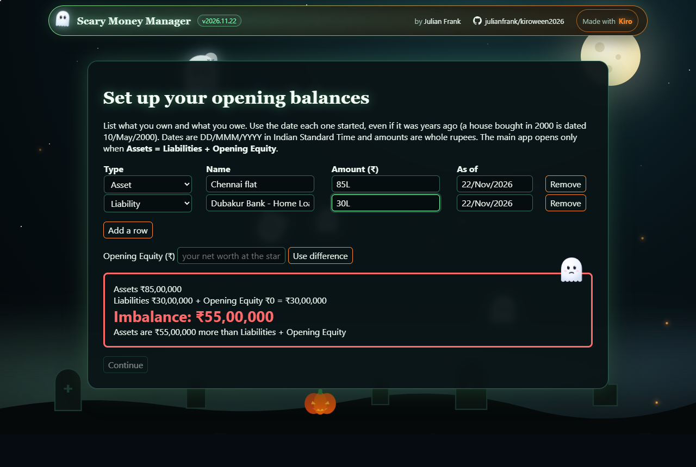 | 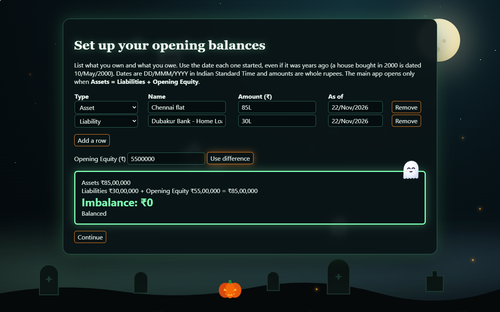 |

List what you own and what you owe, backdated if you like ("House, as of 10/May/2000"). The Imbalance shows until **Assets = Liabilities + Opening Equity**, and "Use difference" fills the Opening Equity in one click.

### 4. Talk to your books
Type in any tab's chat. The ghost's Proposed Entry appears on a **Confirm Card** with its Debit and Credit lines, the IST date and a Note that quotes you. Ask in the wrong tab and it offers to switch ("That looks like a Daily Updates entry. Switch there?"). If the model is unsure, the same card becomes a pre-filled form.

### 5. The ghost's note
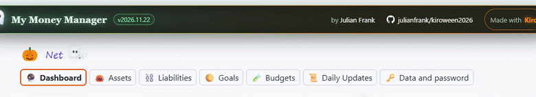

Under the title, a ghost with a quill writes one line at a time about your real situation: net worth, this month's spending, your biggest expense, budgets over the limit, goals nearly brewed. After a random 2 to 4 minutes the ink lifts and it writes another. Cross into the red and it rewrites at once.

### 6. The dashboard: where did the money go?
| In the black | Lights out |
|---|---|
| 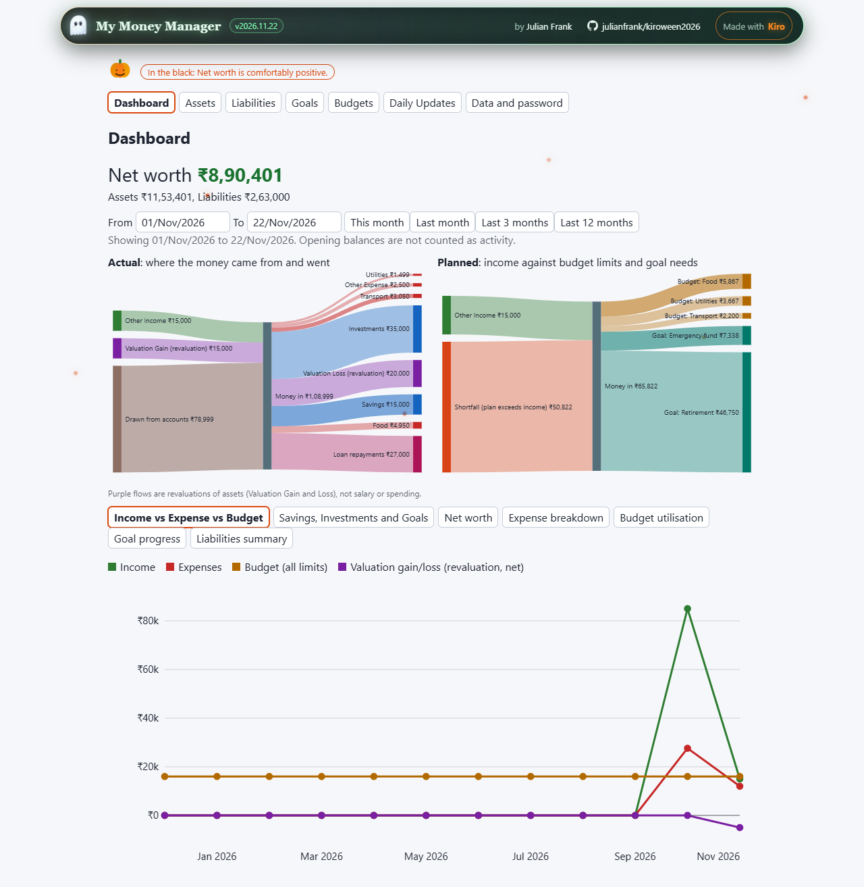 | 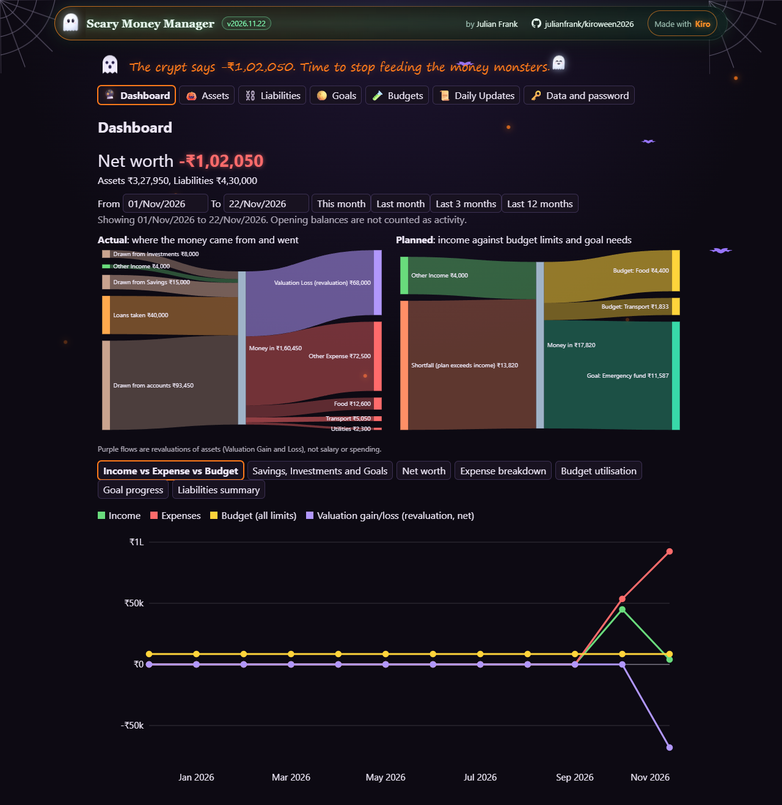 |

Two Sankey diagrams side by side: **Actual** (income, loans and drawn savings flowing into spending, saving, repayments and what was kept) and **Planned** (income against budget limits and goal needs, with any shortfall). Below them are seven charts: income vs expense vs budget, savings vs goals, net worth over time, expense breakdown, budget utilisation, goal progress with a projected date, and liabilities.

### 7. Your data, your file
The **Data and password** tab exports one encrypted JSON file (optionally under a different password) and downloads an **Export Template** (JSON Schema plus an annotated example) so other tools can read or write the format. It also imports, changes the password, runs the AI check, and starts over.


## How to use it

1. Open https://julianfrank.github.io/kiroween2026/ in **Google Chrome on a desktop** (Windows 10/11, macOS 13+, Linux or Chromebook Plus). The built-in model needs about 22 GB of free disk and a GPU with more than 4 GB of VRAM, or 16 GB of RAM. Edge, Safari, Firefox and phones show a clear "use Chrome" screen.
2. Wait for **Ready to Work** (press "Download and start" the first time).
3. Type a password of 7+ characters, then **Try a sample** for instant data, or **Start New Database** for your own books.
4. Try the chat: *"Paid Rs.800 for groceries yesterday"* (Daily Updates), *"I've taken a loan of Rs.5000 from Tom"* (Liabilities), *"Set a monthly budget of 8000 for Food"* (Budgets), *"Save 3L for an emergency fund by Dec 2027"* (Goals), *"My car is now worth 3.8L"* (Assets).
5. Fix a mistake from Daily Updates with **Reverse** or **Correct**. Nothing is ever edited or deleted.

---

## Architecture

### The big picture
Everything runs inside one browser tab. There is no server: the app is a single static file, and Chrome itself provides the model, the crypto and the storage.

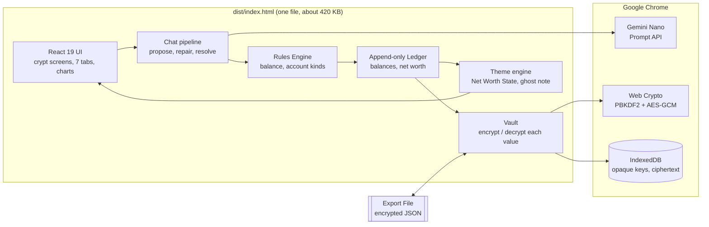

### From a sentence to a saved Entry
The model is treated as a parser, never a calculator. Every step after it is deterministic app code with tests.

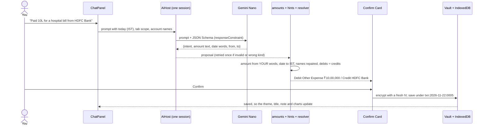

### Security model

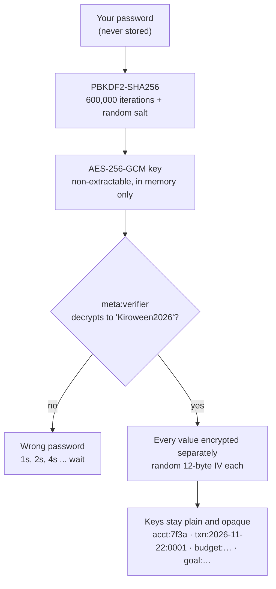

- **What an attacker with your browser sees:** opaque keys and ciphertext. No names, amounts or notes.
- **Import is all-or-nothing:** the file's envelope, password and every decrypted item are checked (shapes, links, balance of every entry, the whole ledger). Only then is the AI session destroyed and the store replaced in one transaction. Any failure changes nothing.
- **The AI forgets:** one global session, destroyed on import, start over and tab close, and rebuilt when its context reaches 80%.
- **A Kiro hook guards the code:** any agent edit that would log a password, key or decrypted value is blocked before it is written.

### The theme engine

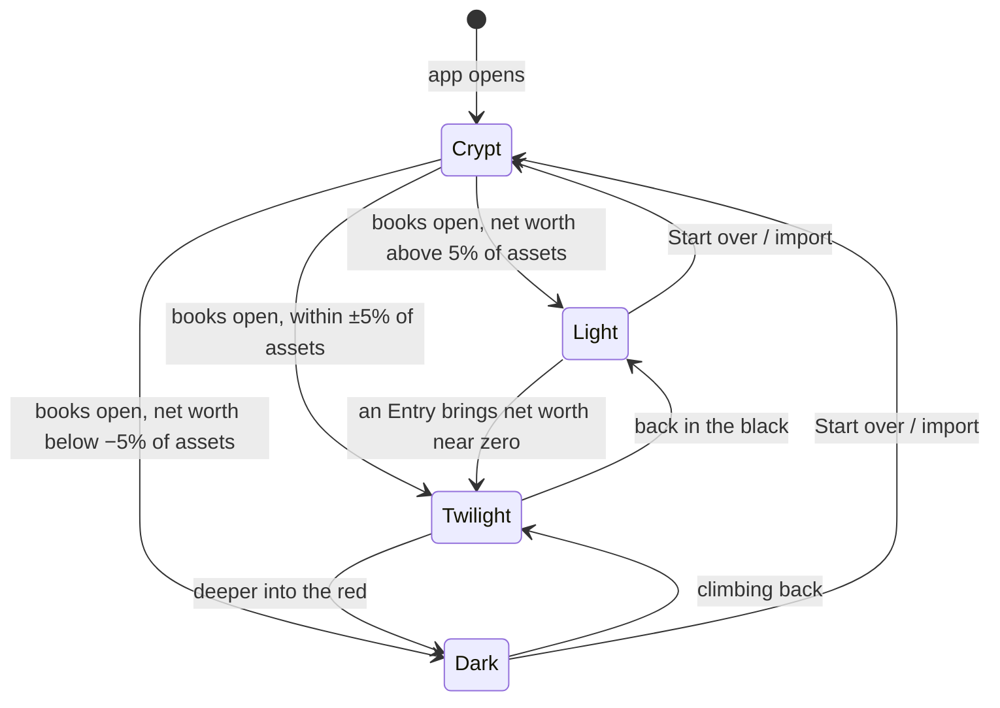

The Net Worth State is a pure function of today's net worth and total assets (no memory), recomputed on every render, so the switch is instant. The crypt is the separate always-dark theme of the entry screens.

### Code map (`src/`)

| Folder | What it does |
|---|---|
| `ai/` | Readiness state machine (check, download, initialise, test); `AiHost`, the one global session with context-aware rebuilds |
| `chat/` | Intents and tab scopes; the schema-constrained `proposeEntry`; `amounts.ts` (amounts from your words); `hints.ts` (repairs account names); `draft.ts` (resolver and account rules) |
| `crypto/`, `store/` | PBKDF2/AES-GCM; `KV` with an atomic `replaceAll`; the `Vault`; the repository (commit, reverse, correct, rename, save all) |
| `ledger/`, `rules/`, `setup/` | Append-only ledger, validators, the opening-balance gate |
| `money/`, `dates/` | Whole rupees with lakh/crore display; IST dates and natural date phrases |
| `targets/`, `charts/` | Budgets and goals (progress from the ledger); pure chart builders; d3-sankey and d3 views |
| `theme/` | Net Worth State, the crypt, ghosts, the ghost's note and its quips, entry animations |
| `export/` | Envelope, validation, the Export Template, download |
| `golden/`, `sample/` | The 36-sentence AI check; the two sample datasets |
| `ui/` | Screens, tabs, Confirm Card, Data and password panel, header |

The full design lives in [`.kiro/specs/scary-money-manager/design.md`](.kiro/specs/scary-money-manager/design.md), the export format in [`export-format.md`](ideas/scary-money-manager/design/export-format.md), and the decisions in [`docs/adr/`](docs/adr/).

---

## How it was built with Kiro

Built from an empty folder in **Kiro IDE**, in Autopilot.

- **Grilled before coding.** The `grill-with-docs` skill ran a 28-question requirements interview, one decision at a time with every option. It produced [`GLOSSARY.md`](GLOSSARY.md), four [ADRs](docs/adr/) and the spec.
- **Spec-driven.** [`.kiro/specs/scary-money-manager/`](.kiro/specs/scary-money-manager/) has requirements (each tagged Q1–Q28), the design, and 12 ordered tasks plus every later change, each with its own tests and demo.
- **Steering.** [`.kiro/steering/`](.kiro/steering/) holds product, tech, structure and rules: the decisions Kiro must not change without asking, and rules learned from real bugs ("never trust the model with amounts").
- **Hooks.** [`.kiro/hooks/`](.kiro/hooks/): unit tests on every save, a guard that blocks logging secrets, and a reminder to keep the status and task list current.
- **Testing.** 220 unit tests, including **8 fast-check property tests** (entries always balance, reversals always cancel, amounts are read in every written form, the setup gate, Net Worth State boundaries, IST "today", export round trip). A mutation check proved they catch bugs. Also **3 Playwright tests** in real Chrome with a fake Prompt API in a New York time zone, and the **golden-sentence check** against the real model.
- **Design skills.** `canvas-design` set the design philosophy for the crypt ([`entry-theme.md`](ideas/scary-money-manager/design/entry-theme.md)), and `slack-gif-creator` assembled the GIFs above from frames Kiro recorded of the running app.

## Run it locally

```bash
npm ci
npm run build      # typecheck, then build dist/index.html (open it straight from disk)
npm test           # 220 unit and property tests
npm run test:e2e   # Playwright in your installed Google Chrome
node e2e/shots.mjs # screenshots; node e2e/record-gifs.mjs then python e2e/make-gifs.py for the GIFs
```

Every push to `main` runs [`.github/workflows/pages.yml`](.github/workflows/pages.yml): install, unit tests, build, and publish `dist/` to GitHub Pages.

---

Made by **Julian Frank** with [Kiro](https://kiro.dev) for Kiroween 2026 · [MIT licence](LICENSE) · Status for agent sessions: [`AGENTS.md`](AGENTS.md)
