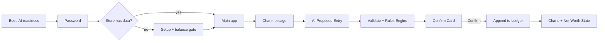

# Design: Scary Money Manager

Requirements: `../requirements/requirements.md`. Terms: root `GLOSSARY.md`. Decisions: `docs/adr/`.

## 1. Stack
Vite, React 19, TypeScript, Vitest, d3 and d3-sankey, `vite-plugin-singlefile`. Output: `dist/index.html`. Source goes in `src/` at the repo root. No server and no network calls after the model is downloaded.

## 2. Flow

## 3. Modules (`src/`)
| Module | Responsibility |
|---|---|
| `crypto/` | PBKDF2 key derivation, AES-GCM encrypt and decrypt of one value, verifier check, wrong-password delay |
| `store/` | IndexedDB wrapper. Reads and writes `key → encrypted value`. Opaque ID generation. Atomic re-encrypt for password change |
| `money/` | Integer paise type, parse (`Rs.5000`, `5,000`, `50k`), lakh/crore formatting |
| `dates/` | Resolver for date phrases (today, yesterday, N days ago, last Friday, ISO dates). Pure functions with an injected "today" |
| `ledger/` | Entry types, append, Reversal and Correction builders, balances by Account and date |
| `rules/` | Balance gate for Setup, Entry validators (debits = credits, Accounts exist, date sane), future-date flag |
| `ai/` | Availability and download state machine, session create and destroy, schema-constrained proposals, retry-once logic, per-tab prompts, context rebuild |
| `charts/` | Pure data builders (Sankey nodes and links, trends, net worth series, budget utilisation, goal projection), then d3 views |
| `theme/` | Net Worth to Net Worth State mapping, CSS variables, animation components |
| `export/` | Export, import, template download, schema validation, replace-all import |
| `ui/` | React screens: readiness, password, setup, six tabs, chat with Confirm Card, manual form |

Pure logic (everything except `ui/`, d3 views, and the browser parts of `ai/` and `store/`) must have no DOM dependency so Vitest can test it.

## 4. Data model
Stored values are JSON, encrypted per item. Shapes are in `export-format.md` (the stored shape and the exported shape are the same).

Key scheme: `acct:<id>`, `txn:<date>:<seq>`, `budget:<id>`, `goal:<id>`, `meta:verifier`, `meta:salt`, `meta:version`.

Derived, not stored: balances, Net Worth, budget progress, goal progress, chart series. They are recomputed from the Ledger whenever it changes (a ledger of a few thousand entries is cheap to scan).

## 5. AI design
- **Readiness states:** `checking`, `needs-download` (Start button), `downloading(percent)`, `initializing`, `testing`, `ready`, `unsupported(reason)`. Always call `LanguageModel.availability()` with the same options later used in `create()` and `prompt()`.
- **Test step:** a short fixed prompt whose reply must contain an expected token.
- **Proposal schema** (passed as `responseConstraint`):
  - `intent`: one of the tab's allowed intents or `other_tab` with `tab`
  - `amountRupees`: number (converted to paise by the app, never trusted for balancing)
  - `dateText`: string
  - `fromAccount`, `toAccount`: names, or `new` with `{name, kind}`
  - `note`: short sentence
  - `missing`: array of fields the user did not give
- The app builds the real balanced Entry lines from the proposal. The model never outputs debit and credit amounts.
- **Prompt context:** system prompt, today's date, the tab's allowed intents, and the list of Account names relevant to the tab. No Ledger history is sent.
- **Session lifecycle:** one global session. Destroy on import. Rebuild when `contextUsage / contextWindow` passes 0.8. After destroy, any call is expected to reject, and a test asserts this. The tab closing frees everything.
- **Failure path:** validate, retry once with the error text, then ask for the missing field and show the manual form pre-filled.

## 6. Setup gate
State: list of opening lines with `asOfDate`, plus Opening Equity. `imbalance = assets − (liabilities + openingEquity)`. The UI shows the imbalance in large type, in red or green. "Use difference" sets Opening Equity to `assets − liabilities`. Continue is enabled only at zero. On continue, one `opening` Entry per Account is written.

## 7. Dashboard
- **Actual Sankey** for range `[from, to]`: sources are Income Accounts (including Valuation Gain). Targets are Expense categories and Savings or Investment Accounts. Valuation Loss is an Expense node labelled as such. If expenses plus savings exceed income, a source node "Drawn from savings" supplies the shortfall.
  - d3-sankey does not allow cycles, so "Drawn from savings" is a separate source node and never the same node as a savings target.
- **Planned Sankey** for the same range: sources are Income (actual income for the range), targets are Budget limits and Goal monthly contributions (target remaining divided by months left, or target divided by 12 when no date), plus "Unallocated".
- **Sub-tabs** (each is a pure data builder plus a d3 view): Income vs Expense vs Budget trend (12 months), Income vs Savings/Investments vs Goals trend, Net worth over time (month-end), Expense breakdown, Budget utilisation, Goal progress with projected completion (average monthly contribution), Liabilities summary.

## 8. Theme and animation
- `netWorthState(netWorth, totalAssets)`: Dark if `netWorth < 0`, Twilight if `|netWorth| ≤ 0.05 × totalAssets`, otherwise Light. Evaluated after each committed Entry and at load.
- Light: white and pale grey "Office" surfaces, orange and purple accents, small pumpkin and ghost touches. Dark: near-black, orange, purple and bone-white, bats and cobwebs. Twilight: dusk gradient between the two.
- Animations (CSS and SVG): coins flow from source Account to target Account on each confirmed Entry, a net worth counter animates, positive states show gentle fireflies, negative states show flickering lights. Always on.
- Colour pairs must keep readable contrast for numbers in all three states.

## 9. Export and import
See `export-format.md`. Import steps: read file, validate envelope, ask for password, derive key, decrypt `meta:verifier`, decrypt and validate every item, then on success: destroy the AI session, clear chat state, wipe the store, write the items, run the balance check. Any failure before the wipe leaves the store unchanged.

## 10. Risks
| Risk | Mitigation |
|---|---|
| Prompt API may not run from `file://` | Task 2 spike. Fallback: serve over `http://localhost` |
| Gemini Nano misreads input | Propose then confirm, golden-sentence accuracy run, manual form |
| PBKDF2 at 600k iterations is slow on weak devices | Show a "deriving key" indicator, measure in Task 4 |
| Context window fills | Rebuild the session at 80% |
| Backdated opening balances distort history | Charts start at each Account's As-of Date |
| Always-on animations can be uncomfortable | Accepted by the user. Revisit if feedback says otherwise |
